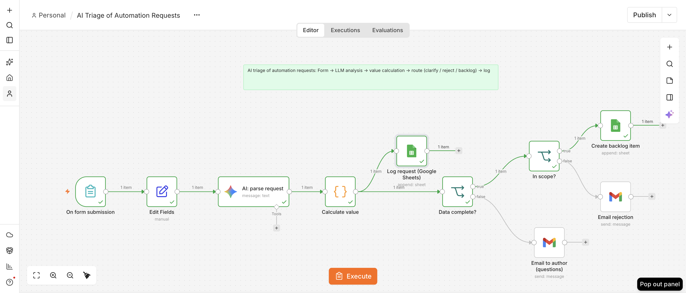
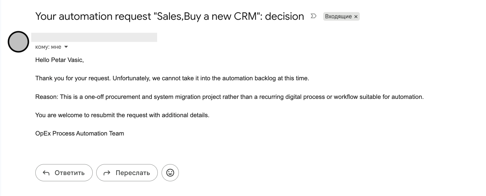
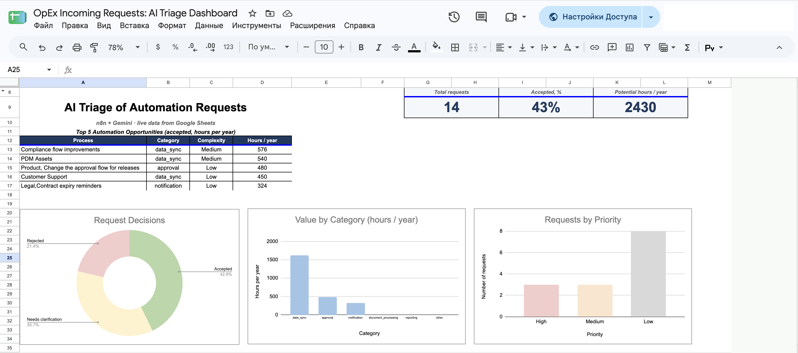

# AI Triage of Automation Requests (n8n + Gemini)

An n8n workflow that triages incoming process-automation requests for an OpEx / process automation team. A requester fills in a form; Gemini classifies the request; the workflow calculates its value, decides what to do with it (accept, ask for details, reject), notifies the author by email and keeps a log and a backlog in Google Sheets.

**Flow:** form → Gemini analysis → value calculation → routing (clarify / reject / backlog) → email + Google Sheets log

## What it does

1. **Form** (`On form submission`): name, email, process name, issue description, frequency per month, minutes per execution, number of people, systems used.
2. **Gemini** (`AI: parse request`, model `gemini-3-flash-preview`) returns JSON: category, automation type, complexity, priority, `in_scope`, scope reason, one-sentence summary, `critical_gaps` and `questions_for_author`.
3. **Code node** (`Calculate value`) parses the answer and applies deterministic rules:
   - monthly hours = frequency × minutes ÷ 60, annual hours = monthly × 12;
   - critical gaps are checked again in code (frequency or duration missing, description shorter than 40 characters, systems empty);
   - decision: `Rejected` (out of scope), `Needs clarification` (critical gaps), otherwise `Accepted`.
4. **Routing:** every request is logged to the `OpEx IR` sheet. Then `Data complete?` and `In scope?` route it:
   - incomplete data → email to the author with numbered questions;
   - out of scope → rejection email with the reason;
   - in scope and complete → new row in the `Backlog` sheet.

## Decision rules

- **In scope:** recurring, rule-based, digital process (data transfer, reporting, notifications, approvals, document processing, syncs between systems).
- **Out of scope:** one-off projects, purchases, hardware or infrastructure incidents, bug reports, strategic or HR-policy decisions, work based on human judgment, office matters. Scope is decided first.
- **Critical gaps** (the only reason to ask for clarification): what is done manually, systems involved, frequency, duration. Everything else (API availability, file formats, MFA, storage location, matching rules) goes to "nice to know" questions and does not block acceptance.
- **Contradictions:** if the description and the "systems" field clearly contradict each other, `systems` becomes a critical gap.

## Setup

1. Import `workflow.json` into n8n (`⋯` → Import from file).
2. Create a Google spreadsheet with two tabs and put these headers in the first row:
   - `Backlog`: `submitted_at, process, author, category, automation_type, complexity, priority, monthly_hours, annual_hours, summary, email, description, systems, freq_month, minutes, people, in_scope, scope_reason, missing_info, questions_for_author, data_complete, decision`
   - `OpEx IR`: `submitted_at, process, author, category, automation_type, complexity, priority, monthly_hours, annual_hours, in_scope, data_complete, decision, summary, email, description, systems, freq_month, minutes, people, scope_reason, missing_info, questions_for_author, content, finishReason, index, critical_gaps`
3. Create credentials in n8n: Google Gemini (PaLM) API, Gmail OAuth2, Google Sheets OAuth2.
4. Open the four nodes with a warning (`Create backlog item`, `Log request (Google Sheets)`, `Email rejection`, `Email to author (questions)`), select your credentials and, for the Sheets nodes, your spreadsheet and tab.
5. Execute the workflow and submit the form at the test URL.

The exported file contains no credentials, no pinned data and no real emails; sheet and credential IDs are placeholders (`YOUR_SHEET_ID`, `YOUR_CREDENTIAL_ID`).

## Test results

I wrote 25 test requests myself (recurring processes, one-off requests, incomplete and contradictory descriptions) and set the expected decision for each by hand. Accuracy is measured on the final decision (`Accepted` / `Needs clarification` / `Rejected`).

| Version | Result | Notes |
|---|---|---|
| v1 | **18 / 25 (72%)** | 7 errors, all in `decision` |
| v2 | **at least 23 / 25 (92%)** | 5 of 5 re-run failures fixed |

**v1 errors:** 5 unnecessary clarification requests (the model treated non-critical details as missing data), 1 out-of-scope request that got a clarification email instead of a rejection (data completeness was checked before scope), 1 missed clarification (the model reported complete data but asked three questions).

**v2 changes:** a closed list of critical gaps in the prompt, scope decided first, a contradiction rule, deterministic gap checks in the code node, and the data-completeness flag no longer blocks rejection of out-of-scope requests.

**Caveats:**
- Two borderline requests (CRM → billing, intercompany invoice check) were not re-run because of the Gemini API quota. Their expected labels were set before the critical-gaps criterion existed; under the new criterion they are expected to flip. Result: TODO.
- The 18 requests that were correct on v1 were not re-run on v2, so regression is not excluded.
- The criterion for a "critical gap" was introduced after the first measurement, so v2 results are not an independent test.

## Known limitations

- For out-of-scope requests `data_complete` is logged as `TRUE` (by design of the routing).
- The minimum-value threshold (1 annual hour) affects only the logged `decision`, not the routing.
- If Gemini returns no questions, the clarification email has an empty list.
- Test set is small and synthetic.

## Possible next steps

- Re-run the two borderline requests and the 18 previously correct ones on v2.
- Add default questions for missing frequency and duration to the clarification email.
- Route by the final `decision` field instead of two separate checks.
- Add a larger test set and an evaluation sheet.

## License

MIT
